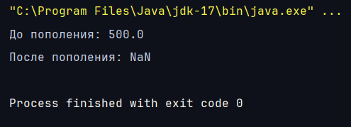

## BUG-2: `BankAccount.deposit` принимает NaN, баланс становится NaN
| Поле        | Значение                                                    |
|-------------|-------------------------------------------------------------|
| Тест-кейс   | TC-1.2.11 (Найден при анализе кода, вне плана тестирования) |
| Компонент   | `BankAccount.deposit(double)`                               |
| Окружение   | Java 17.0.12, JUnit 5.10.1, Maven, коммит `59558b1`         |
| Серьёзность | High                                                        |
| Приоритет   | High                                                        |
| Статус      | Open                                                        |

**Предусловия:** нет

**Шаги воспроизведения:**
1. Создать счёт: `new BankAccount("Alice", 500)`.
2. Вызвать `deposit(Double.NaN)` у созданного объекта.
3. Вызвать `getBalance()`

**Фактический результат:** исключение не выбрасывается, `getBalance()` возвращает `NaN` (до операции баланс был `500.0`) .

**Ожидаемый результат:** `IllegalArgumentException` с сообщением `"Deposit amount must be positive"`. 

**Причина:** проверка `amount <= 0` не срабатывает для `NaN`, потому что любое сравнение с `NaN` возвращает `false`.

**Последствия:** после такой операции проверка достаточности средств перестаёт работать (`amount > balance` для `NaN` всегда ложно), поэтому `withdraw(100)` проходит без ошибки, а баланс остаётся `NaN`.

**Связанные случаи:** `deposit(Double.POSITIVE_INFINITY)`, `withdraw(Double.NaN)`, конструктор с `NaN` в качестве начального баланса.

**Доказательство:** 

**Автотест:** TC-1.2.11 помечен `@Disabled("BUG-2")` до исправления.